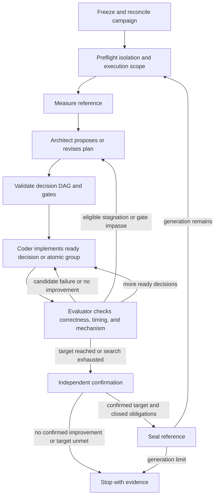

# ForgeKernel workflow design

Status: proposed design, 2026-10-29. This document specifies a future `forge_kernel` flow.
It adds no executable flow, release, index manifest, or performance result.

Selected delivery uses the existing Ralph loop with the [task agent.md](../ralph-loop/agent.md).
This design is maintained in `qhy991/flowverse` for personal use. Do not create an upstream PR
or register a release in the official index as part of this work.

## Personal Ralph configuration

Put the linked instructions in the owning kernel task's `agent.md`. Make every fresh Ralph
activation read it, the frozen task contract, and the task's current evidence record.
One existing Ralph agent performs both architecture reasoning and code changes in separate
steps. A second agent and a new workflow implementation are unnecessary for this configuration.

Each activation selects its next action from the recorded evidence: inspect the reference,
test a hypothesis, implement a decision, evaluate the candidate, or revisit architecture after
stagnation. Save the candidate identity, verifier result, unresolved question, and next action
in the task's existing record so a fresh activation can continue.

The instruction file owns the operational rules. The task's existing verifier owns acceptance.
Prompt instructions guide agent behavior; they do not implement deterministic job recovery,
source isolation, or automatic reference promotion. Report those capabilities as unavailable
unless the owning task already enforces them.

The dedicated flow below remains an optional implementation design. It has not been implemented
and is not required to adopt the Ralph instructions.

## Problem and intended behavior

A kernel search can stop improving because its early architecture decisions remain fixed.
ForgeKernel addresses that failure by analyzing a measurable reference, building a decision
curriculum, reopening architecture decisions when measurements stall, and carrying accepted
kernels and certified knowledge into later campaigns.

The proposed implementation uses one async hmz flow, two agents, and a trusted evaluator.
The flow owns research control. The evaluator owns measurements and gate verdicts. Each new
generation starts with an opaque reference handle and fresh, isolated agent sessions.

The first implementation targets the public hmz interface at
[`58dd43a`](https://github.com/humanfia/humanize/blob/58dd43a419b9d1967c8028f3b999192b040b7b60/src/hmz/flows/__init__.py).
This interface uses async flows, `AgentCollection`, `EnvCollection`, `FlowParams`, and
`FlowContext`. It differs from the older synchronous tuple-agent API. No compatibility layer
is proposed. An implementation must load and execute against its pinned runtime before release.

## Usage from the caller's view

The caller supplies a frozen task contract, a campaign directory, model bindings for architect
and coder, and deployment bindings for their environments and the evaluator. The deployment
provides existing execution authorization. Supplying this design grants none.

The source repository exposes a path-loadable `forge_kernel` entry. A calling flow passes
the configured roles, environments, and complete parameters through the public `Flow` protocol:

```python
result = await run(
	"Run the frozen operator task",
	agents=roles,
	envs=workspaces,
	params=Params(contract="task.json", campaign="campaign"),
)
```

A CPU integration test uses the same entry:

```python
result = await run(
	"Exercise interrupted candidate recovery",
	agents=fake_roles,
	envs=fake_workspaces,
	params=Params(contract="fixtures/task.json", campaign="scratch/campaign"),
)
```

These are proposed call sites. The future implementation supplies the named bindings and fixture.
A resumed invocation supplies the same frozen task and bindings. A changed contract
or workflow revision starts a separate campaign; it cannot silently reuse accepted results.

The flow returns a report containing artifact references. It also writes `outcome.json` as a
projection for command-line users. The report distinguishes the best development candidate,
confirmed result, promoted reference, unresolved job, and stop reason. Missing measurements
remain missing.

## Frozen task contract and owners

The task issuer freezes the following before execution:

- Operator semantics, input shapes, dtypes, precision rules, state mutation, and output ABI.
- Hardware and toolchain scope, reference handle, and fixed library comparison baseline.
- Independent numerical judge, measurement protocol, profiler channels, and mechanism predicates.
- Per-generation target ratio, calibrated noise rule, confirmation protocol, and stopping limits.
- Evaluator binding, execution scope, device allocation, and reserved confirmation capacity.
- Initial certified knowledge revision and rules for adopting later certified revisions.

The generation reference controls that generation's targets and mechanism anchors. The library
baseline remains fixed for cumulative reporting. Neither agent can change either identity.

| Fact or artifact | Canonical owner |
| --- | --- |
| Task, judge policy, measurement policy, and execution scope | Task issuer and owning executor |
| Plan revision, active decision, incumbent reference, counters, next action, and stop reason | One flow controller and its durable campaign record |
| Candidate source after handoff | Immutable candidate store outside later generations' agent access |
| Jobs, raw measurements, gate verdicts, confirmation, and sealed reference payloads | Trusted evaluator |
| Certified recipes and scoped no-go entries | Existing knowledge publisher, with one writer |
| hmz progress, outcome report, and human-readable summaries | Projections of campaign control and evaluator records |

The controller is the only campaign-state writer. Architect and coder submit proposals.
The evaluator can retain its existing native task runner and device ledger; this design does
not require a new benchmark framework or a second resource allocator.

## Public entry and internal contracts

The following are proposed signatures, not shipped code. hmz symbols are existing public APIs;
`Report`, request records, and campaign helpers belong to the future flow implementation.

```python
class Agents(AgentCollection):
	architect: Agent
	coder: Agent

class ExecutorEnv(Env, ShellEnvMixin): ...

class Envs(EnvCollection):
	analysis: Env
	code: Env
	executor: ExecutorEnv

class Params(FlowParams):
	contract: str
	campaign: str

@flow(agents=Agents, envs=Envs, params=Params, resumable=True)
async def run(
	task: str, *, agents: Agents, envs: Envs,
	params: Params, ctx: FlowContext,
) -> Report: ...

async def exchange(request: Request, executor: ExecutorEnv) -> Reply: ...
def revise(plan: Plan, patch: PlanPatch) -> Restart: ...
def next_action(campaign: Campaign, receipt: VerifiedReceipt | None) -> Action: ...
```

The flow imports hmz APIs only from `hmz.flows`. Architect and coder use
`await agent.spawn()` and `await agent.run(..., session=session, env=workspace,
output_schema=Proposal)`. Schema validation checks proposal structure; it confers no evidence
authority. The controller invokes the evaluator directly, without requiring agent tool callbacks.
`ShellEnvMixin.exec(argv, timeout=...)` provides an existing command boundary with no shell
expansion. `_executor.py` translates the deployment's native executor reports into the records below.

| Record | Required meaning |
| --- | --- |
| `Decision` | ID, action, purpose, trigger, cost, dependencies, atomic group, and verification predicate |
| `Plan` | Revision, milestone membership, decision records with dependencies, gate obligations, and source evidence; derive DAG indexes from those records |
| `Candidate` | Immutable source identity, parent, generation, plan revision, and implemented decisions |
| `Request` | Stable operation ID, operation kind, frozen inputs, execution scope, and policy identities |
| `Reply` | Exactly one of pending, completed, or unavailable; pending and unknown retain operation identity |
| `VerifiedReceipt` | Evaluator identity, request and job identities, source bindings, raw evidence references, and typed verdict |
| `Campaign` | Frozen task and workflow identity, generation, reference, plan, incumbent, pending operation, counters, and terminal state |

The exchange operations are preflight, reference analysis, candidate evaluation, confirmation,
mechanism probe, and reference sealing. Submission and reconciliation use the same operation
ID. Candidate identity, task, hardware, judge, reference, and protocol must match the request
before a receipt can influence control. Authentication comes from trusted executor storage or
an authenticated deployment channel, not an agent-editable JSON file.

The first source package has three modules:

```text
forge_kernel/
  __init__.py    role declarations, prompts, async flow, and private orchestration helpers
  _campaign.py   domain records, plan revision, next-action policy, and atomic control record
  _executor.py   native executor boundary, immutable receipt validation, and knowledge publisher binding
tests/           CPU scenarios and separately admitted native integration checks
README.md
LICENSE
```

There is one supported entry point. Add a subflow or another module only when an actual
consumer needs a separate interface.

## Search and generation transitions



Every stage also stops new work on a budget limit, missing capability, unresolved job, or
interruption. These outcomes keep their own reasons and do not follow a success edge.

1. **Reconcile before work.** Acquire the campaign's exclusive writer lock. Check the frozen
   identities and recover the exact pending operation. A competing controller or an unresolved
   prior job prevents further side effects.
2. **Analyze and validate.** Give the architect sanitized reference observations and a pinned
   certified knowledge snapshot. Mark unresolved explanations as hypotheses. Validate decision
   fields, dependency acyclicity, atomic groups, provenance, and measurable gate predicates.
3. **Implement.** Give the coder one ready decision or an indivisible atomic group. Treat M0
   as an architectural unit. Snapshot source before evaluation and preserve the prior incumbent.
4. **Evaluate and retain.** The numerical judge runs before timing. A structural M0 pass needs
   correctness, architecture, and mechanism evidence, but no absolute reference-performance
   threshold. It can establish a development incumbent without claiming an improvement.
   Later replacements require evaluator-accepted improvement over that incumbent under the
   frozen noise rule. Compare contender and incumbent in the same job when deciding a replacement;
   measure the generation reference there as well.
5. **Reopen architecture.** After three eligible measured attempts without a new best, decision
   exhaustion, or a gate impasse, return evidence to the architect. Compile and correctness
   failures have bounded repair attempts; they do not diagnose a performance plateau. Infrastructure
   failures do not increment candidate stagnation. These eligibility rules are engineering choices
   that make the paper's three-iteration trigger explicit.
6. **Apply a revision.** An additive patch preserves unaffected work. A foundation patch invalidates
   dependent decisions and expands the restart set to complete atomic groups. Re-evaluate affected
   obligations under the new plan. Old measurements remain historical evidence under their old revision.
7. **Confirm.** Freeze the selected candidate and run fresh confirmation samples under the frozen
   protocol. Development samples cannot substitute for confirmation. For `g = t_reference / t_candidate`,
   promotion requires the confirmed target `g >= target_ratio` and a gain above the calibrated noise
   rule, plus correctness and all applicable mechanism obligations.
8. **Seal and continue.** Record promotion intent, then obtain an idempotent sealing receipt for the
   exact confirmed candidate. The next generation uses that opaque reference, reanchors its plan,
   and passes isolation preflight before any new role turn. A candidate below the target remains a
   reported development result; it does not silently lower the target or become a promoted reference.

Gate lines have `PASS`, `DEFERRED`, `INFEASIBLE`, `N/A`, or `UNRESOLVED` dispositions.
`DEFERRED` requires measured attainability, evidence that current levers do not discharge the
line, and a named downstream lever that receives it. `INFEASIBLE` needs metric-specific evidence.
`N/A` means structural inapplicability. Deferral is an obligation transfer; it cannot leave a
required final obligation open at promotion. Estimates cannot satisfy measured gates.

The paper's per-phase +5% target and 1% to 5% noise range are examples, not universal defaults.
The frozen protocol sets repetitions, summary statistics, cache and graph settings, tolerance,
profiler channels, and the confirmation rule. A plateau is a result of this bounded search,
not proof of hardware optimality.

## Recovery and stop semantics

Use one atomically replaced, revisioned campaign control record, plus immutable plans, operation
intents, and evaluator receipts. Hold a process-lifetime exclusive OS lock on a supported local
filesystem for every state write and external request. A second controller refuses the lock;
there is no expiring lease or manual lock-file deletion. Require atomic replacement and checked
file/directory durability on that filesystem. Do not claim distributed locking guarantees.
Preserve superseded artifacts. A checked durable write precedes each external effect. A failed
or ambiguous write stops new effects. A generic event database is unnecessary.

The controller records the complete operation request before calling `exchange`. The evaluator
must durably associate that ID with at most one job before acknowledging submission. Repeating
the request returns or reconciles the same job; a different body under the same ID is rejected.

| Interruption point | Required recovery |
| --- | --- |
| Intent recorded, submission not acknowledged | Reconcile the same operation ID before any resubmission |
| Device job submitted, response lost | Retrieve that job; preserve pending or unknown status if it cannot be resolved |
| Receipt published, control update absent | Validate and apply that receipt once |
| Reference sealed, promotion update absent | Recover the same sealed handle and complete the control transition once |
| Agent reply or dirty source not committed | Recover or repeat proposal work; do not submit it as accepted source |

The same operation rule covers independent probes and knowledge publication. The knowledge
publisher must reconcile the certification ID before another admission attempt. A timeout
cannot create two certified entries for one proposal.

Persist each model action's ID, exact prompt/evidence snapshot, role and environment binding,
and session identity before the turn. Recover a committed reply by that ID where supported.
An uncertain turn remains uncertain and its known spending remains charged. A fresh proposal
requires the frozen retry policy and verified remaining runtime allowance; do not assume model
calls are idempotent or that starting another hmz run resets the campaign's allowance. If the
runtime cannot establish prior spending, stop with that uncertainty before another paid turn.

`ctx.state` stores a top-level campaign ID and revision as a progress projection. Its public
`FlowState` protocol supports item reads, writes, deletion, and membership; do not assume `get`,
`update`, or persistence of mutations inside nested values. A stale hmz cursor cannot reset the
campaign, budgets, or pending operation. Role bindings, frozen task text, environment identity,
and workflow revision are also recorded, so a restart cannot silently change execution conditions.

Stop reasons distinguish `target_confirmed`, `noise_plateau`, `target_unmet`, `attempt_limit`,
`generation_limit`, `runtime_budget_exhausted`, `device_budget_exhausted`, `blocked_capability`,
`blocked_infrastructure`, `invalid_contract`, and `interrupted`. Terminal reports reference
outstanding jobs explicitly. Process exit never establishes job completion or resource release.

hmz owns model cost, token, and duration limits. The owning evaluator separately reserves and
accounts for device allocation, including actual costs of infrastructure failures. Reserve mandatory
confirmation capacity before spending the remainder on search. The flow adds no duplicate model
budget meter. Cancellation and resource release require the owning executor's existing authority.

## Reference isolation and knowledge reuse

Preflight must bind the actual selected agent backends and environments to verified restrictions.
Only the evaluator can access reference payloads, judge state, acceptance records, and credentials.
Architect sees decisions and sanitized measurements. Coder sees its current-generation source.
Neither can read reference source or modify the evaluator and knowledge publisher.

A new session or a different working directory does not enforce this boundary. Before the next
generation, previous source, build products, transcripts, and persistent agent memory must be
inaccessible to the new role sessions. Human evidence archives remain available outside that
access boundary. The adapter must demonstrate these restrictions for the actual deployment.
If it cannot, return `blocked_capability`; do not run a source-readable fallback under the same claim.

Both roles may propose a recipe. Independent probes on the named architecture must certify its
mechanism before the existing knowledge publisher admits it. A recipe contains its trigger,
scope, minimal runnable example, caveats, and probe provenance. Deterministic lint excludes
reference-specific code and names from the agent-readable recipe. A successful candidate does
not certify every explanation that accompanied it.

A no-go entry requires measured negative evidence, its symptom, scope, and retry precondition.
Budget exhaustion, outages, and unmeasured suggestions are not certified no-gos. The controller
records proposed and reused recipe IDs. A generation reads a frozen certified snapshot; new
certifications become available at the next declared snapshot boundary. No automatic public
knowledge publication is part of this flow.

## Alternatives and synthesis decision

Two independent sketches compared one async controller with campaign/generation subflows.
The single controller is the base. A complete generation subflow adds a second durable lifecycle
handoff. A proposal-only subflow avoids that ownership split but adds little beyond a private
helper. There is no second consumer that needs it yet. The synthesis keeps the smaller three-module
layout, explicit invocation identities, and immutable generation handoff from the subflow sketch.

An evaluator-owned search engine would hide more control behind one call, but would also own
model conversations and research policy. Keep that policy in the flow. An LLM judge cannot own
measurement acceptance. Legacy atlas and synchronous APIs are outside the pinned target.

The accepted tradeoff is a small controller with a real trusted execution boundary. That boundary
must reuse and qualify an existing executor; prompt text alone cannot supply its capabilities.
No implementation has occurred, so there are no implementation deviations to reconcile.

## Implementation and acceptance sequence

| Unit | Uncertainty it resolves | Required observable evidence |
| --- | --- | --- |
| Current hmz load and CPU scenario | Do the declared async roles, environments, params, and resume entry execute? | Actual pinned-runtime load and flow execution with fake roles and evaluator |
| Plan and gate logic | Can bad dependency revisions or fabricated evidence change the best or promotion? | Focused scenarios reject cycles, invalid bindings, unresolved final obligations, and false M0 performance requirements |
| Recovery | Can interruption duplicate a job, seal, or accepted update? | Inject interruption at each boundary above; retain one operation/job, one promotion, and visible unresolved state |
| Error and budget handling | Can an outage look like a candidate failure or reset spending? | Infrastructure errors preserve stagnation and recorded costs; search preserves confirmation capacity |
| One native task | Does the actual executor enforce isolation and accept the intended judge/timing commands? | Preflight denial checks, independent correctness, rejected candidate, paired timings, mechanism evidence, and confirmation receipts |
| Second generation and knowledge | Does source isolation survive promotion, and does knowledge require its own proof? | Old-source/transcript access denied, new reference remeasured, one separately certified recipe, and a measured scoped no-go |
| Method comparison | Does added control earn its cost? | Fixed tasks, models, budgets, baseline, stopping rule, and repeated paired comparison against direct loop; separate architecture-reopen and knowledge ablations |

Implement the thinnest single-generation slice before adding promotion and knowledge publication.
Write focused tests after the domain interface and failure semantics are stable. CPU scenarios
establish control behavior only. Native qualification and method comparison require their own
execution authorization and frozen protocols; neither is claimed by this design submission.

The first deployment must name an existing executor that can enforce isolation and exact-job
reconciliation, plus the owning knowledge publisher. These are execution prerequisites, not
reasons to add a new general service or weaken the method.

## Repository placement and publication

This fork's current `main` is a release index. Keep this design outside `flows/`. Future source
belongs in its own repository with the package, tests, README, and license. After actual runtime
and native acceptance, any release remains in the user's own source repository and fork index.
An entry in that fork would use `flows/qhy991/forge_kernel/<version>/flow.yaml` and pin the real
tested commit under the [manifest rules](../../CONTRIBUTING.md#the-manifest).
Official-index registration and upstream PRs are outside this delivery scope and require a new
explicit user request. Do not invent a source repository URL, tag, or commit in advance.

This proposal does not change hmz core, published manifests, the index schema, or CI policy.
For the optional dedicated flow, the first implementation unit is the single-generation controller
and fake evaluator recovery scenario, followed by one authorized native-task binding.

## Sources and evidence boundary

- User-supplied manuscript, *ForgeKernel: Self-Evolving Kernels Catching and Surpassing Experts
  and Agents*, §§3.1-3.5, Appendices B, C, and G, and conclusion. These support the architecture
  curriculum, measured gates, reference promotion, certified knowledge, and bounded-plateau claim.
  This document copies no manuscript code, figures, or performance tables.
- Public humanize commit `58dd43a419b9d1967c8028f3b999192b040b7b60`,
  [flow definitions and state](https://github.com/humanfia/humanize/blob/58dd43a419b9d1967c8028f3b999192b040b7b60/src/hmz/flows/defining.py),
  [agent sessions and structured output](https://github.com/humanfia/humanize/blob/58dd43a419b9d1967c8028f3b999192b040b7b60/src/hmz/flows/agents.py),
  and [environment commands](https://github.com/humanfia/humanize/blob/58dd43a419b9d1967c8028f3b999192b040b7b60/src/hmz/flows/envs.py).
  Source inspection establishes interface grounding, not successful execution of this proposed flow.
- This index's [README](../../README.md) and [publication rules](../../CONTRIBUTING.md).

The atomic control record, operation reconciliation, explicit error taxonomy, eligible-stagnation
rule, and deployment preflight are engineering choices in this proposal. They preserve the
method across hmz and external jobs; they are not claims about APIs implemented by the paper.
